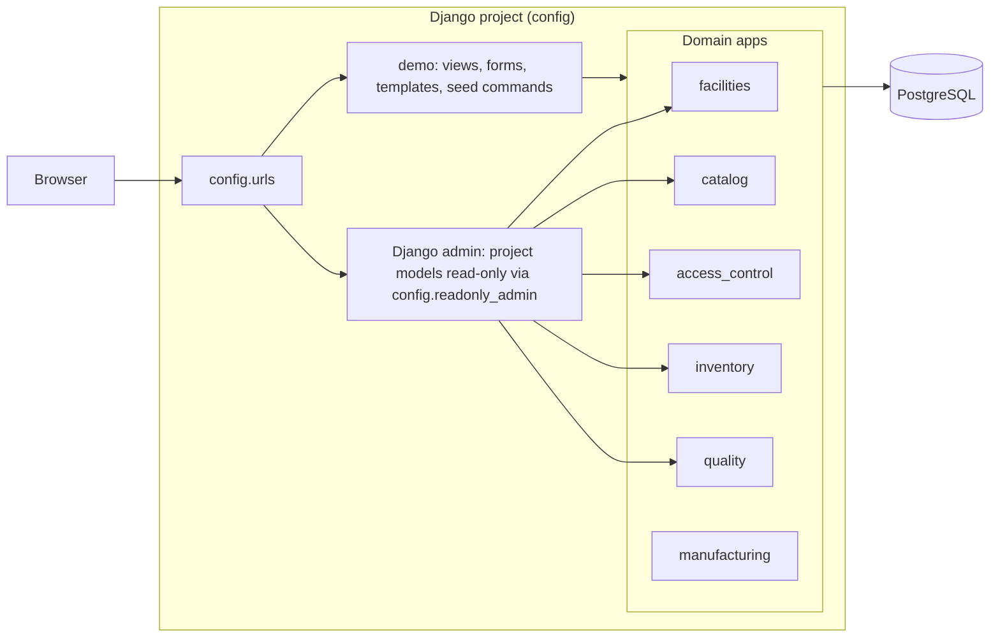
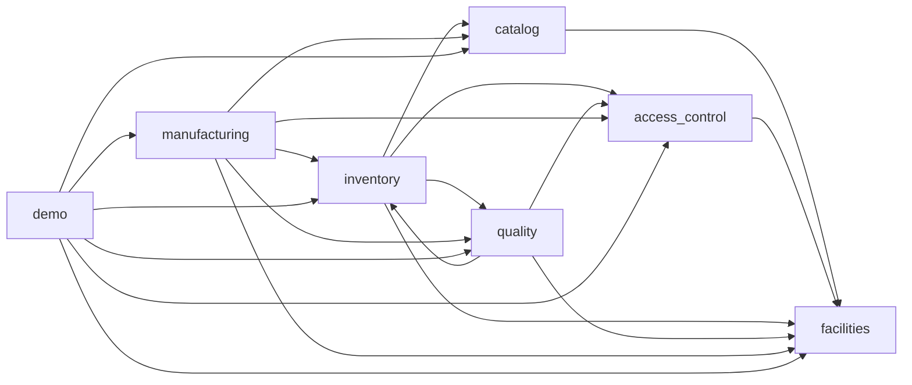
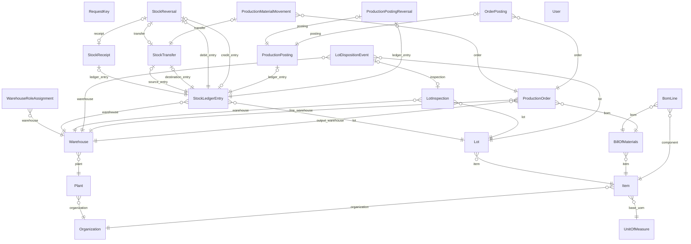
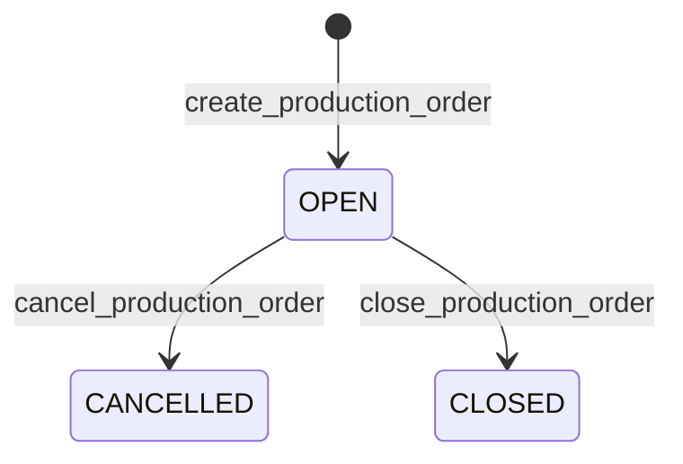
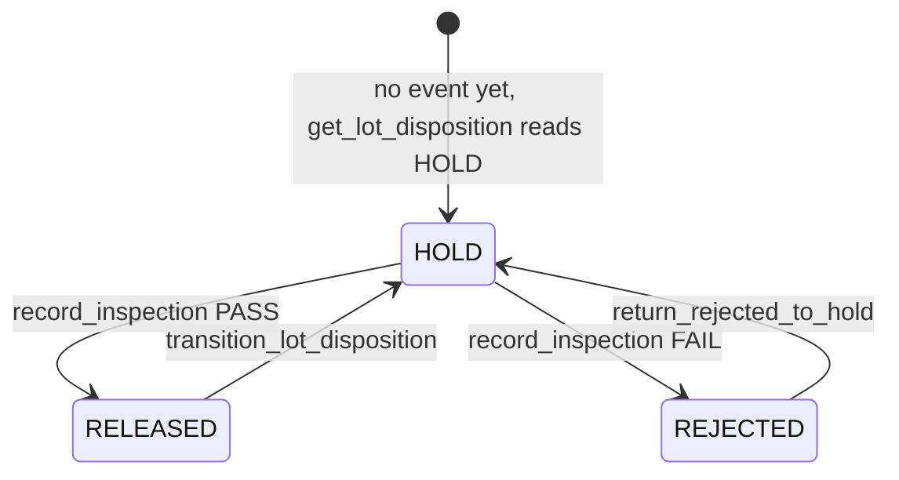
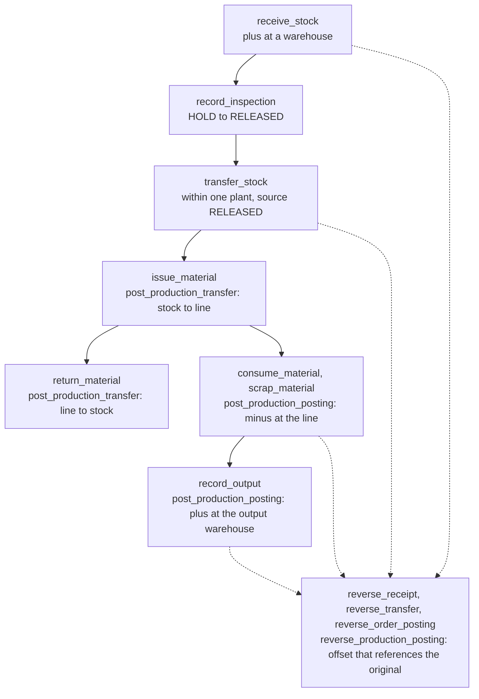

# Architecture and domain diagrams

The diagrams in this file are drawn from the code in this repository
([Issue #123](https://github.com/porntaned/ERP-for-Factory/issues/123), M7.3). Most of them are
checked against the code by `tests/docs/test_architecture_diagrams.py`, which runs in the normal
test suite; the [last section](#how-the-check-works) says exactly what is checked and what is
only reviewed by hand.

- [(a) Modules](#a-modules)
- [Read-only admin coverage](#read-only-admin-coverage)
- [(b) App dependencies](#b-app-dependencies)
- [(c) Domain model](#c-domain-model)
- [(d) States](#d-states)
- [Stock-movement flow](#stock-movement-flow)
- [Domain ownership](#domain-ownership)
- [How the check works](#how-the-check-works)

## (a) Modules

One Django project (`config`) runs every app in one process against one PostgreSQL database.
`config.urls` routes the screens to the `demo` app (`demo.views`, `demo.production_views`,
`demo.quality_views`), login and logout to Django's auth views, and `/admin/` to the Django
admin. `demo` has no models; it calls the six domain apps. There is no deployment: the project
runs locally and in CI only.

<!-- architecture-check: modules -->


The `admin` arrows go only to the apps that have models in the admin. `manufacturing` has none.

## Read-only admin coverage

Every project model in the admin is registered through `config.readonly_admin.register_read_only`,
which uses `config.readonly_admin.ReadOnlyAdmin`: no add, change or delete permission, so the
admin cannot bypass the Inventory and Quality commands.

| App | Registered / total | Not registered |
| --- | --- | --- |
| `facilities` | 3 / 3 | — |
| `catalog` | 2 / 2 | — |
| `access_control` | 1 / 1 | — |
| `inventory` | 6 / 8 | `ProductionPosting`, `ProductionPostingReversal` |
| `quality` | 2 / 2 | — |
| `manufacturing` | 0 / 5 | `BillOfMaterials`, `BomLine`, `ProductionOrder`, `ProductionMaterialMovement`, `OrderPosting` (there is no `manufacturing/admin.py`) |

`demo` has no models. Django's own `auth` app also registers `User` and `Group`, with Django's
default admin classes; those two are not read-only and are not part of this table.

## (b) App dependencies

An arrow `X --> Y` means that code in app `X` imports app `Y`.

<!-- architecture-check: app-dependencies -->


**The `inventory` ↔ `quality` cycle is shown as it is.** `inventory` imports `quality` to read
the Lot disposition (`inventory.transfers`, `inventory.reversals`, `inventory.transfer_policy`,
`inventory.lot_gate`). `quality` imports `inventory`: `quality.models` points to
`inventory.models.Lot`, and `quality.services` reads stock and Lot origin, partly through imports
inside functions (`quality.services.record_inspection` imports
`inventory.services.get_stock_balance`; `quality.services.inspection_kind` imports
`inventory.models`). M7.3 documents the cycle and does not change it.

Only `demo` imports `manufacturing`.

## (c) Domain model

Entities are the models of the six domain apps, grouped by app; the relationship label is the
field name. Fields are not shown. Cardinality is read source side first:

| Field | Notation |
| --- | --- |
| `ForeignKey` | `}o--\|\|` (`}o--o\|` when `null=True`) |
| `OneToOneField` | `\|o--\|\|` (`\|o--o\|` when `null=True`) |

`User` is Django's `auth.User` (`AUTH_USER_MODEL` is not overridden). It is drawn as an external
node without edges: the fields that point to it (actors, creators, approvers, inspectors) are
not drawn and not checked.

<!-- architecture-check: domain-er -->


`RequestKey` has no relation fields. A `StockReversal` references either a receipt or a transfer,
never both (database check constraint `stock_reversal_one_original`); only a transfer reversal
has a `credit_entry` (`stock_reversal_credit_iff_transfer`).

## (d) States

### Production order (`manufacturing.models.ProductionOrder.status`)

The states are the values of `manufacturing.models.OrderStatus`. An order is created `OPEN`
(the field default) by `manufacturing.services.create_production_order`.
`manufacturing.services.cancel_production_order` and
`manufacturing.services.close_production_order` accept only an `OPEN` order; no command moves an
order out of `CANCELLED` or `CLOSED`. Cancelling needs an empty line and no net output; closing
needs an empty line, and a shortfall reason when net output is below the order quantity.

<!-- architecture-check: production-order-states -->


### Lot disposition (`quality.models.LotDisposition`)

The disposition belongs to one Lot at one warehouse. It is the `to_disposition` of the latest
`quality.models.LotDispositionEvent` for that pair; a pair without events is `HOLD`
(`quality.services.get_lot_disposition`). Each event records `from_disposition` and
`to_disposition`, and only these commands write events:

- `quality.services.record_inspection` (QUALITY role at the warehouse) inspects a `HOLD` pair:
  `PASS` gives `RELEASED`, `FAIL` gives `REJECTED`.
- `quality.services.transition_lot_disposition` (QUALITY role) only moves `RELEASED` back to
  `HOLD`.
- `quality.services.return_rejected_to_hold` (APPROVER role, not the inspector who rejected the
  Lot) moves `REJECTED` back to `HOLD`.

<!-- architecture-check: lot-disposition-states -->


While a Lot is `REJECTED` at any warehouse, Inventory refuses to receive, transfer, issue,
return, consume or output it, and to reverse a transfer, consumption or scrap of it
(`inventory.lot_gate.require_lot_not_rejected`, which reads
`quality.services.get_rejected_warehouses`). Scrap and the reversal of a receipt or output stay
allowed because they only take stock out.

## Stock-movement flow

This flow is reviewed by hand; the test only checks that every function it names exists in a
module on its `%% functions:` line. Every step except the inspection posts
`inventory.models.StockLedgerEntry` rows through an Inventory function; the stock balance of a
Lot at a warehouse is the sum of its entries (`inventory.services.get_stock_balance`).

<!-- architecture-check: stock-flow -->


1. **Receipt.** `inventory.services.receive_stock` (WAREHOUSE role) writes one
   `inventory.models.StockReceipt` with one positive entry. It does not change the Quality state;
   a new Lot-warehouse pair reads `HOLD`.
2. **Inspection.** `quality.services.record_inspection` releases or rejects the pair.
3. **Transfer.** `inventory.transfers.transfer_stock` (WAREHOUSE role at both ends) writes a
   debit and a credit entry and one `inventory.models.StockTransfer`, between warehouses of one
   plant, from a `RELEASED` source.
4. **Issue and return.** `manufacturing.services.issue_material` and
   `manufacturing.services.return_material` call `inventory.transfers.post_production_transfer`
   (PRODUCTION role at both ends; an issue needs a `RELEASED` source, a return a `RELEASED`
   destination) and link the transfer to the order with
   `manufacturing.models.ProductionMaterialMovement`.
5. **Consumption, scrap and output.** `manufacturing.services.consume_material`,
   `manufacturing.services.scrap_material` and `manufacturing.services.record_output` call
   `inventory.production.post_production_posting`: CONSUME and SCRAP debit the order's line,
   OUTPUT credits the order's output warehouse, where a new output Lot reads `HOLD` until it is
   inspected. The order link is `manufacturing.models.OrderPosting`.
6. **Reversal.** `inventory.reversals.reverse_receipt` and `inventory.reversals.reverse_transfer`
   write an `inventory.models.StockReversal` that references the original receipt or transfer.
   `manufacturing.services.reverse_order_posting` (a new reversal only while the order is
   `OPEN`) calls `inventory.production.reverse_production_posting`, which writes an
   `inventory.models.ProductionPostingReversal` that references the original posting.

## Domain ownership

The rules are in [AGENTS.md](../AGENTS.md#domain-ownership); this is where the code carries them
out.

- **Inventory** owns stock quantities and movements. Ledger entries are created only in the
  `inventory` app: `inventory.services.receive_stock`, `inventory.transfers.transfer_stock`,
  `inventory.transfers.post_production_transfer`, `inventory.production.post_production_posting`,
  `inventory.reversals.reverse_receipt`, `inventory.reversals.reverse_transfer` and
  `inventory.production.reverse_production_posting`. Inventory also enforces movement
  eligibility: the `RELEASED` gate in its transfer commands and in
  `inventory.reversals.reverse_transfer`, and `inventory.lot_gate.require_lot_not_rejected`.
- **Quality** owns inspection decisions: `quality.services.record_inspection`,
  `quality.services.transition_lot_disposition` and `quality.services.return_rejected_to_hold`
  write the `quality.models.LotDispositionEvent` history, and Inventory reads it through
  `quality.services.get_lot_disposition` and `quality.services.get_rejected_warehouses`.
- **Manufacturing** keeps orders and BOMs and moves stock only through the Inventory interfaces
  `inventory.transfers.post_production_transfer` (issue, return),
  `inventory.production.post_production_posting` (consumption, scrap, output) and
  `inventory.production.reverse_production_posting` (reversal). For output into a new Lot code,
  `manufacturing.services.record_output` creates the `inventory.models.Lot` row itself before it
  calls Inventory.
- **Accounting** is not built: there is no accounting app, no valuation and no financial posting.
- **Corrections reference the original.** PostgreSQL refuses to update or delete a ledger entry
  (trigger `inventory_stock_immutable`); a reversal is a new record that points to the original
  (`inventory.models.StockReversal`, `inventory.models.ProductionPostingReversal`).

## How the check works

Each checked diagram is a ` ```mermaid ` block preceded on its own line by
`<!-- architecture-check: NAME -->`, with one statement per line. The test reads this file and
compares it with the code without a database: `django.apps.apps.get_models()`, model `_meta`,
`admin.site._registry` and `ast` over the app sources. Each comparison is an exact set equality
and the failure message lists what is missing from this file and what is extra.

| Marker / section | What the test compares |
| --- | --- |
| `modules` | the apps the `admin` node points to = the project apps with a model in `admin.site._registry` |
| Read-only admin coverage | each row = the registered and total models of that app; every project model in the admin uses exactly `config.readonly_admin.ReadOnlyAdmin` |
| `app-dependencies` | nodes = the seven project apps; edges = cross-app imports (rules below) |
| `domain-er` | entities = the project models except `AUTH_USER_MODEL`, each under its `%% app:` line; edges = every concrete `ForeignKey` / `OneToOneField` between them as (source, target, field name), with the cardinality above |
| `production-order-states`, `lot-disposition-states` | states = the values of `OrderStatus` / `LotDisposition`; every transition names a function |
| `stock-flow` and the two state diagrams | every snake_case name in the block is a function of a module listed on its `%% functions:` line |
| the whole file | every backticked dotted name that starts with a project app or `config` imports and resolves |

App-dependency rule: an edge `X --> Y` exists when any `.py` file of app `X` has `import Y…` or
`from Y… import …` anywhere in it, including inside functions. Files under `migrations/` and
`tests/`, the `config` package, imports within the same app, relative imports and imports of
Django, the standard library or other packages are not counted.

`User` and its edges may be drawn but are never compared. Which arrow joins which states, the
stock-flow arrows and the prose are reviewed by hand. The test also runs the comparisons on
edited copies of this file (a missing and an extra entity, a missing ER edge, an extra
dependency, a wrong cardinality, an extra state) to show that each one is reported.

Run only this check (it needs `.env` because the Django settings require the PostgreSQL
variables, but it opens no database connection):

```bash
uv run --env-file .env pytest tests/docs
```
