# Demo screenshots (M7.4)

Screenshots of the web screens on three paths: **Inventory (M4)**, **Production (M5)** and
**Quality and trace (M6)**. All data is synthetic; nothing is deployed. The screen text is Thai,
as the UI really is; this page explains each screen in English.
[Issue #129](https://github.com/porntaned/ERP-for-Factory/issues/129) asked for this page.

## How the screenshots were taken

- **Data:** `seed_production_demo --reset` (it flushes every table, then runs `seed_demo`), then
  `set_demo_passwords --password-stdin` with a throwaway password, then
  `DJANGO_DEBUG=true … runserver` (development check on local PostgreSQL 16, not CI).
- **Code:** commit `f72aee0` (`main` at `4b53756` plus one documentation-only commit; no app change).
- **Browser:** Playwright Chromium, viewport width 1280 px, `deviceScaleFactor` 1, full page. The
  script ran outside the repository and is not part of it. The page's Bootstrap 5.3.3 stylesheet
  (`cdn.jsdelivr.net`) was served from the npm package `bootstrap@5.3.3`, because the sandbox cannot
  reach the CDN.
- **Actions:** every change shown was made through the real login page and forms, in the order of
  this page, each step logged in as the user that holds the permission for it. Read pages
  (balances, history, orders, genealogy, trace) need only a login; **ประวัติ QC** needs QUALITY or
  APPROVER.

To reproduce, follow the [Install guide](INSTALL.md) (sections 7–9 load and reset the demo data and
start the server); the [Development guide](DEVELOPMENT.md) has the step-by-step walkthroughs these
screens follow. Your timestamps and record numbers may differ if you take other steps first.

Evidence per step: the Issue, the PR that delivered the screen or rule, and the PR's CI comment
(PostgreSQL 18.6; posted by CI on the pull request).

## Inventory (M4)

### 1. Balances

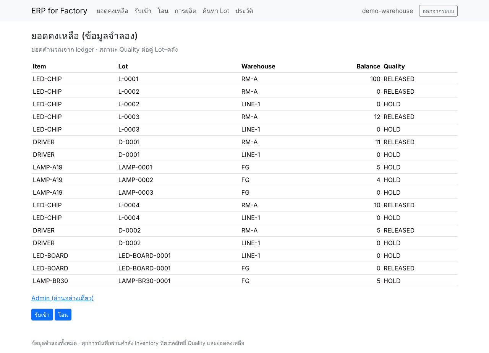

User `demo-warehouse`. The balance page after the seed: L-0001 holds 100 at RM-A, RELEASED; the
production seed has used L-0002, L-0003 and D-0001, and LAMP-0001 (5), LAMP-0002 (4) and
LAMP-BR30-0001 (5) wait in FG as HOLD.

Evidence: [Issue #63](https://github.com/porntaned/ERP-for-Factory/issues/63) ·
[PR #64](https://github.com/porntaned/ERP-for-Factory/pull/64) ·
[CI comment](https://github.com/porntaned/ERP-for-Factory/pull/64#issuecomment-6628511323)

### 2. Receipt form

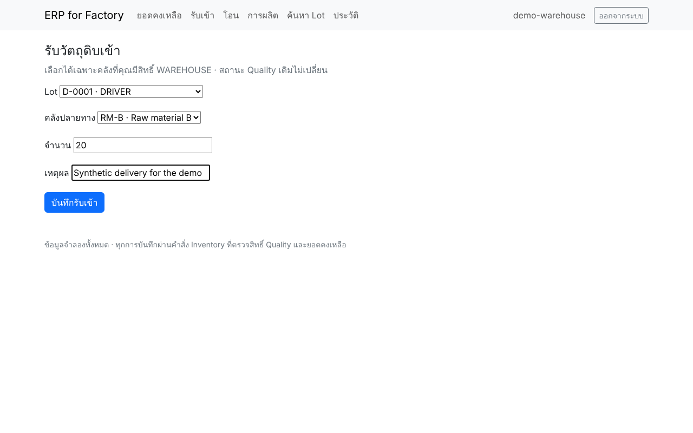

User `demo-warehouse`. **รับเข้า**: receive 20 of DRIVER Lot D-0001 into RM-B. Only warehouses where
the user holds WAREHOUSE can be chosen. The result is in the next balance screenshot (D-0001 RM-B
20 HOLD: a new Lot-warehouse pair starts in HOLD).

Evidence: [Issue #63](https://github.com/porntaned/ERP-for-Factory/issues/63) ·
[PR #64](https://github.com/porntaned/ERP-for-Factory/pull/64) ·
[CI comment](https://github.com/porntaned/ERP-for-Factory/pull/64#issuecomment-6628511323)

### 3. Transfer form

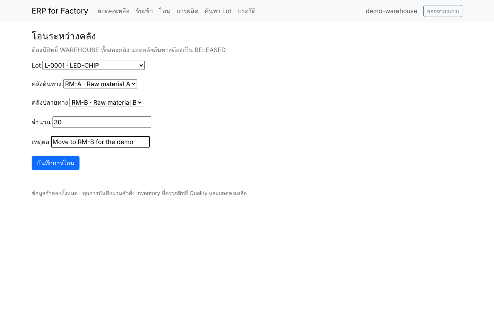

User `demo-warehouse`. **โอน**: transfer 30 of L-0001 from RM-A to RM-B, the M4.7 walkthrough.

Evidence: [Issue #66](https://github.com/porntaned/ERP-for-Factory/issues/66) ·
[PR #67](https://github.com/porntaned/ERP-for-Factory/pull/67) ·
[CI comment](https://github.com/porntaned/ERP-for-Factory/pull/67#issuecomment-6632274173)

### 4. Balances after the transfer

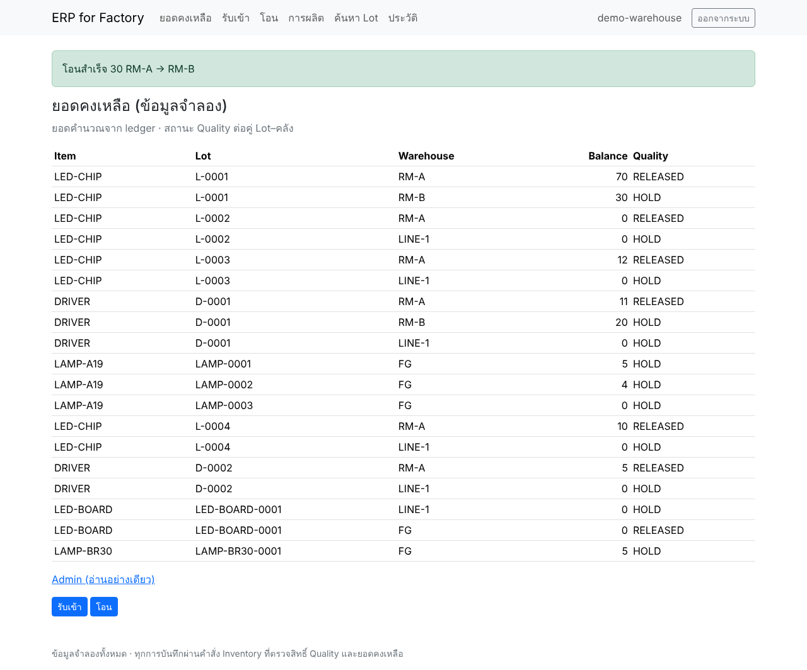

User `demo-warehouse`. "โอนสำเร็จ 30 RM-A → RM-B": L-0001 is now RM-A 70 RELEASED and RM-B 30 HOLD
(the destination keeps its own Quality state). D-0001 RM-B 20 HOLD comes from step 2.

Evidence: [Issue #66](https://github.com/porntaned/ERP-for-Factory/issues/66) ·
[PR #67](https://github.com/porntaned/ERP-for-Factory/pull/67) ·
[CI comment](https://github.com/porntaned/ERP-for-Factory/pull/67#issuecomment-6632274173)

### 5. History with reversal buttons

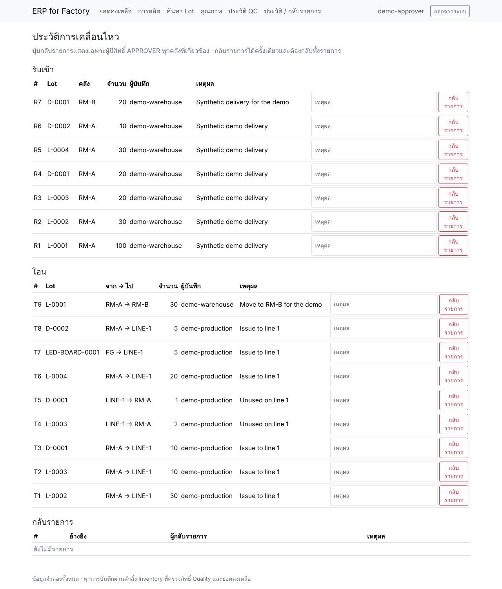

User `demo-approver`. **ประวัติ / กลับรายการ** lists receipts R1–R7 (R7 is step 2) and transfers
T1–T9 (T9 is step 3; T1–T8 are the seed's issues to and returns from LINE-1). Each row has a
**กลับรายการ** button with a reason field because this user holds APPROVER at every warehouse
involved; `demo-warehouse` sees the same page without buttons. Nothing was reversed here, so the
reversal table is empty.

Evidence: [Issue #59](https://github.com/porntaned/ERP-for-Factory/issues/59) ·
[PR #60](https://github.com/porntaned/ERP-for-Factory/pull/60) ·
[CI comment](https://github.com/porntaned/ERP-for-Factory/pull/60#issuecomment-6626829977) (reversal);
screen: [PR #64](https://github.com/porntaned/ERP-for-Factory/pull/64) ·
[CI comment](https://github.com/porntaned/ERP-for-Factory/pull/64#issuecomment-6628511323)

## Production (M5)

### 6. Production orders

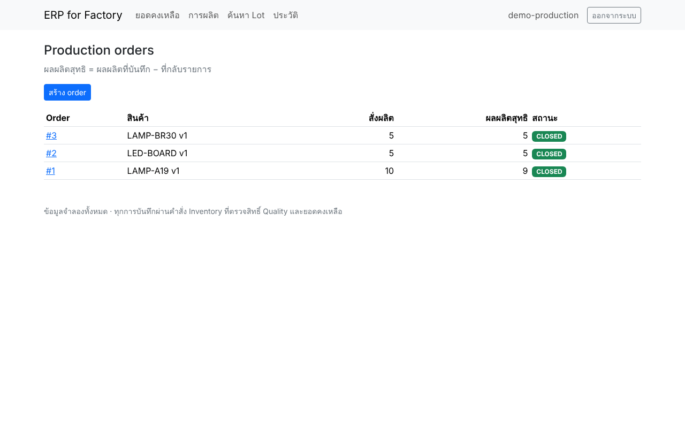

User `demo-production`. **การผลิต**: three closed orders from the seed: #1 LAMP-A19 10 ordered, net
output 9; #2 LED-BOARD 5 / 5; #3 LAMP-BR30 5 / 5. **สร้าง order** shows because this user holds
PRODUCTION.

Evidence: [Issue #89](https://github.com/porntaned/ERP-for-Factory/issues/89) ·
[PR #90](https://github.com/porntaned/ERP-for-Factory/pull/90) ·
[CI comment](https://github.com/porntaned/ERP-for-Factory/pull/90#issuecomment-6652899139)

### 7. Order #1

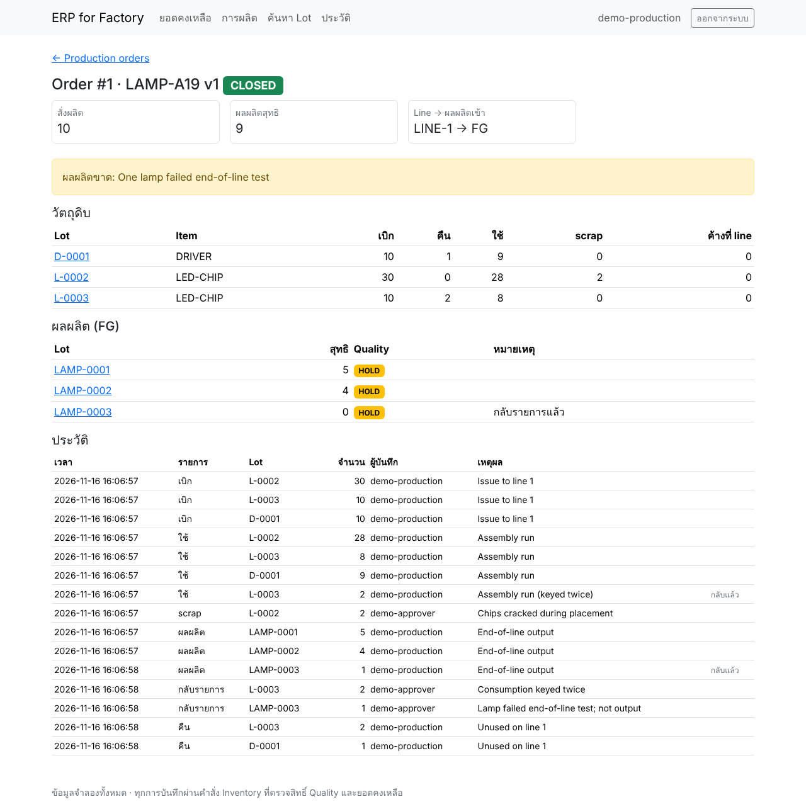

User `demo-production`. Order #1, CLOSED, net output 9 of 10 with the shortfall reason "One lamp
failed end-of-line test". Materials: D-0001 issued 10, returned 1, used 9; L-0002 30 / 0 / 28,
scrap 2; L-0003 10 / 2 / 8. Outputs: LAMP-0001 5 and LAMP-0002 4 (HOLD); LAMP-0003 was reversed to
0. The history shows the mistaken second use of L-0003 2 and its reversal by `demo-approver`.

Evidence (seeded path): [Issue #85](https://github.com/porntaned/ERP-for-Factory/issues/85) ·
[PR #87](https://github.com/porntaned/ERP-for-Factory/pull/87) ·
[CI comment](https://github.com/porntaned/ERP-for-Factory/pull/87#issuecomment-6651862386);
screen: [Issue #89](https://github.com/porntaned/ERP-for-Factory/issues/89) ·
[PR #90](https://github.com/porntaned/ERP-for-Factory/pull/90) ·
[CI comment](https://github.com/porntaned/ERP-for-Factory/pull/90#issuecomment-6652899139)

### 8. Lot genealogy

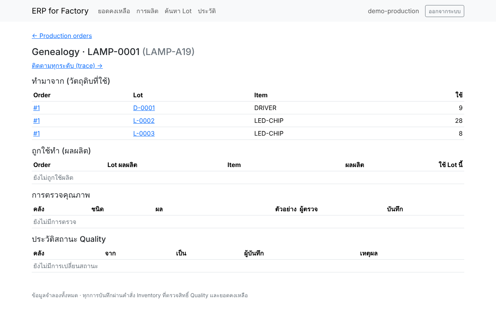

User `demo-production`. LAMP-0001 (opened from order #1) was made from D-0001 9, L-0002 28 and
L-0003 8 in order #1. It has no inspection yet; **ติดตามทุกระดับ (trace)** links to the full trace.

Evidence: [Issue #78](https://github.com/porntaned/ERP-for-Factory/issues/78) ·
[PR #79](https://github.com/porntaned/ERP-for-Factory/pull/79) ·
[CI comment](https://github.com/porntaned/ERP-for-Factory/pull/79#issuecomment-6646106029);
screen: [PR #90](https://github.com/porntaned/ERP-for-Factory/pull/90) ·
[CI comment](https://github.com/porntaned/ERP-for-Factory/pull/90#issuecomment-6652899139)

## Quality and trace (M6)

### 9. Inspection form

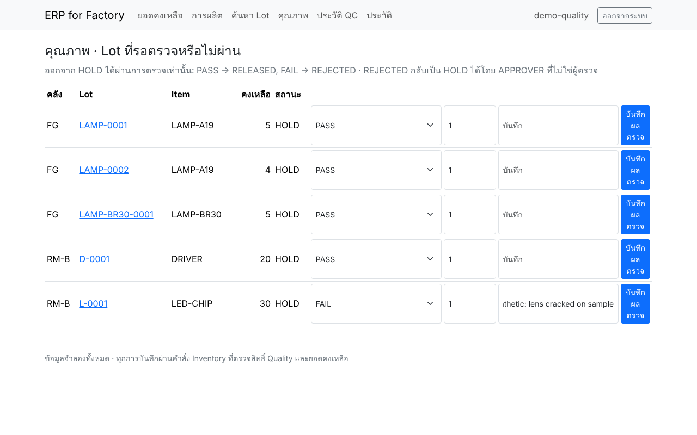

User `demo-quality`. **คุณภาพ** lists the HOLD pairs where this user holds QUALITY: LAMP-0001,
LAMP-0002 and LAMP-BR30-0001 at FG, and D-0001 (20) and L-0001 (30) at RM-B from steps 2 and 4.
On L-0001 at RM-B: result FAIL, sample 1, note "Synthetic: lens cracked on sample".

Evidence: [Issue #96](https://github.com/porntaned/ERP-for-Factory/issues/96) ·
[PR #101](https://github.com/porntaned/ERP-for-Factory/pull/101) ·
[CI comment](https://github.com/porntaned/ERP-for-Factory/pull/101#issuecomment-6686196300)

### 10. Lot rejected

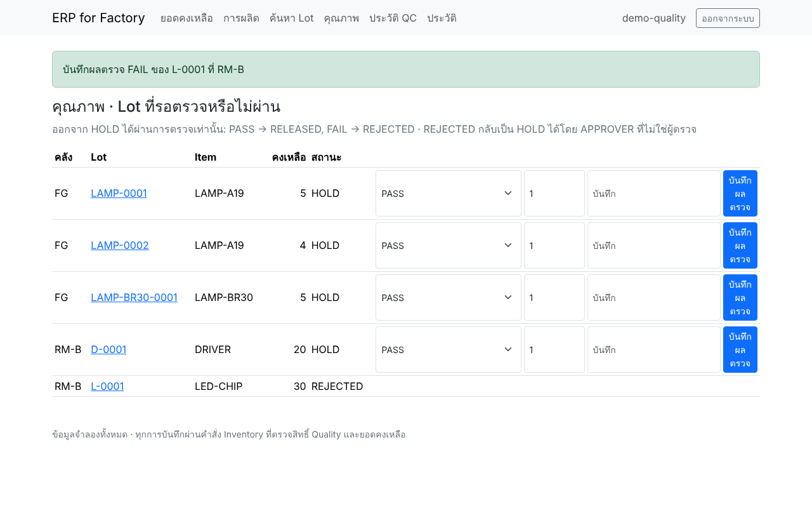

User `demo-quality`. "บันทึกผลตรวจ FAIL ของ L-0001 ที่ RM-B": the pair is REJECTED. Only an APPROVER
who is not the rejecting inspector can return it to HOLD, so this user gets no button on the row.

Evidence: [Issue #96](https://github.com/porntaned/ERP-for-Factory/issues/96) ·
[PR #101](https://github.com/porntaned/ERP-for-Factory/pull/101) ·
[CI comment](https://github.com/porntaned/ERP-for-Factory/pull/101#issuecomment-6686196300)

### 11. Movement refused

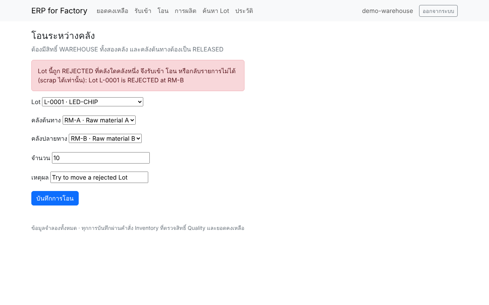

User `demo-warehouse`. Transferring 10 more of L-0001 from RM-A (still RELEASED) to RM-B is refused:
"Lot นี้ถูก REJECTED ที่คลังใดคลังหนึ่ง … Lot L-0001 is REJECTED at RM-B". Nothing is recorded.

Evidence: [Issue #103](https://github.com/porntaned/ERP-for-Factory/issues/103) ·
[PR #104](https://github.com/porntaned/ERP-for-Factory/pull/104) ·
[CI comment](https://github.com/porntaned/ERP-for-Factory/pull/104#issuecomment-6691022466)

### 12. Returned to HOLD

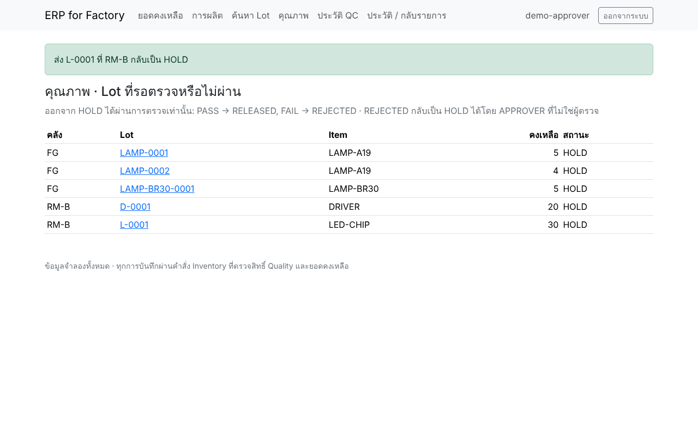

User `demo-approver`. With the reason "Synthetic: re-inspect after sorting", **ส่งกลับ HOLD** returns
L-0001 at RM-B to HOLD ("ส่ง L-0001 ที่ RM-B กลับเป็น HOLD"); it can be inspected again. This user
holds APPROVER, not QUALITY, so the list has no inspection forms.

Evidence: [Issue #96](https://github.com/porntaned/ERP-for-Factory/issues/96) ·
[PR #101](https://github.com/porntaned/ERP-for-Factory/pull/101) ·
[CI comment](https://github.com/porntaned/ERP-for-Factory/pull/101#issuecomment-6686196300)

### 13. Lot trace

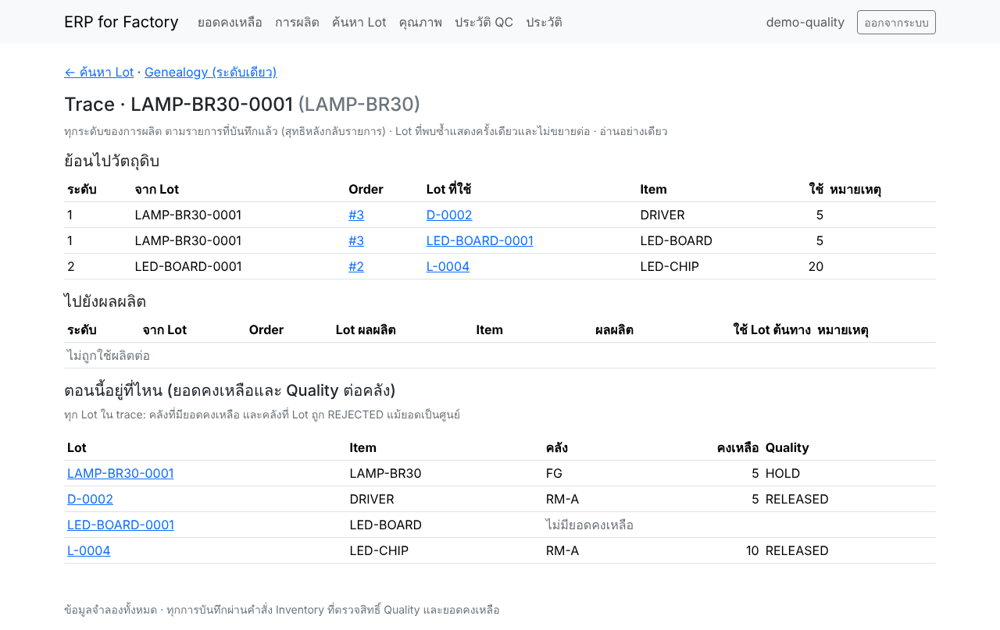

User `demo-quality`. **ค้นหา Lot** with `LAMP-BR30-0001` opens its trace: order #3 used D-0002 5
and LED-BOARD-0001 5 (level 1); order #2 used L-0004 20 (level 2). Nothing used the lamp further.
Positions: LAMP-BR30-0001 FG 5 HOLD, D-0002 RM-A 5 RELEASED, LED-BOARD-0001 no balance, L-0004 RM-A
10 RELEASED.

Evidence: [Issue #108](https://github.com/porntaned/ERP-for-Factory/issues/108) ·
[PR #111](https://github.com/porntaned/ERP-for-Factory/pull/111) ·
[CI comment](https://github.com/porntaned/ERP-for-Factory/pull/111#issuecomment-6786212132)

### 14. QC history

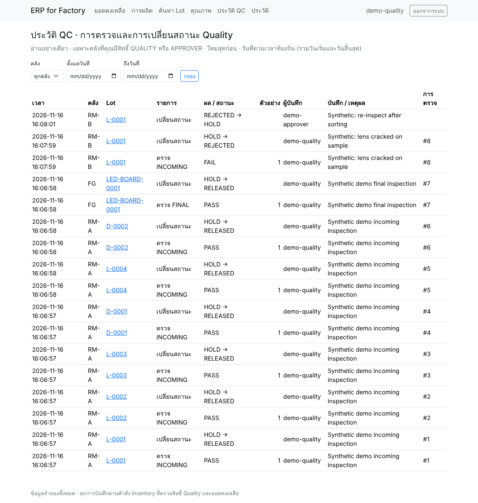

User `demo-quality`. **ประวัติ QC**: 17 rows, newest first. The top three are steps 12, 10 and 9:
REJECTED → HOLD by `demo-approver`, HOLD → REJECTED and the FAIL inspection #8 (INCOMING, sample 1)
by `demo-quality`. Below them are the seed's 14 rows: seven passing inspections and their
HOLD → RELEASED events.

Evidence: [Issue #113](https://github.com/porntaned/ERP-for-Factory/issues/113) ·
[PR #114](https://github.com/porntaned/ERP-for-Factory/pull/114) ·
[CI comment](https://github.com/porntaned/ERP-for-Factory/pull/114#issuecomment-6792246771)
